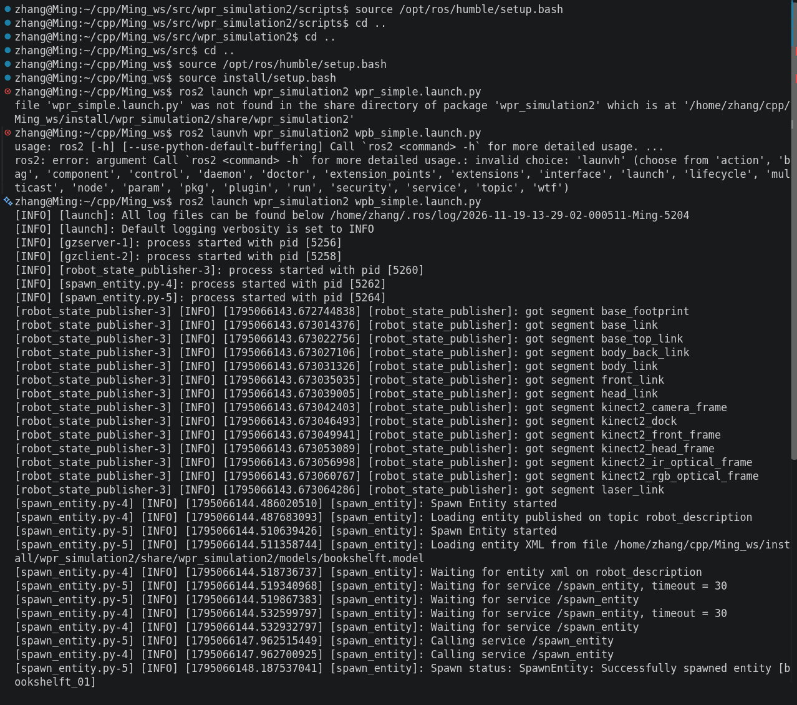
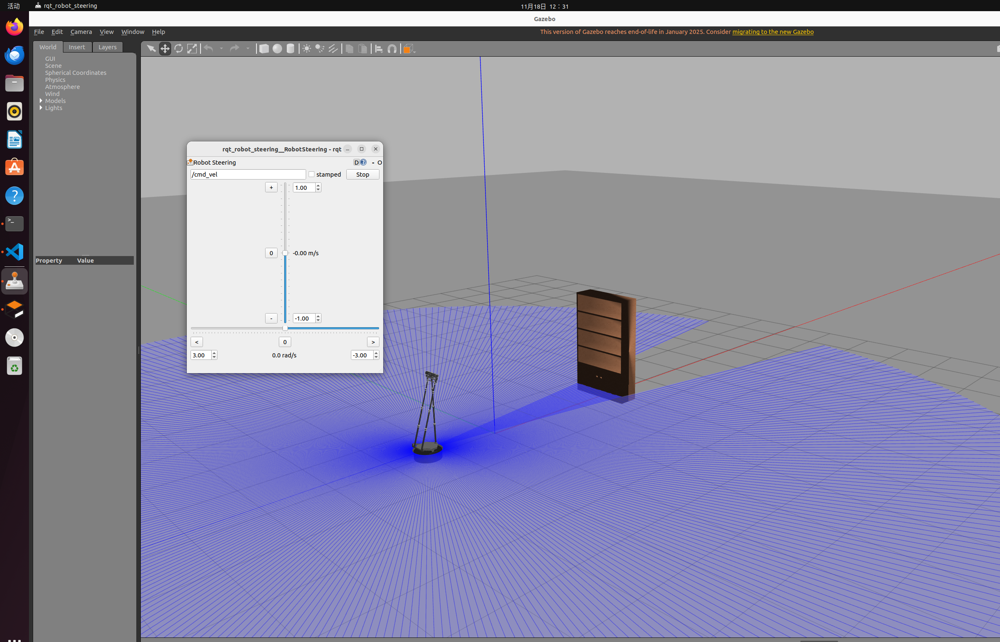
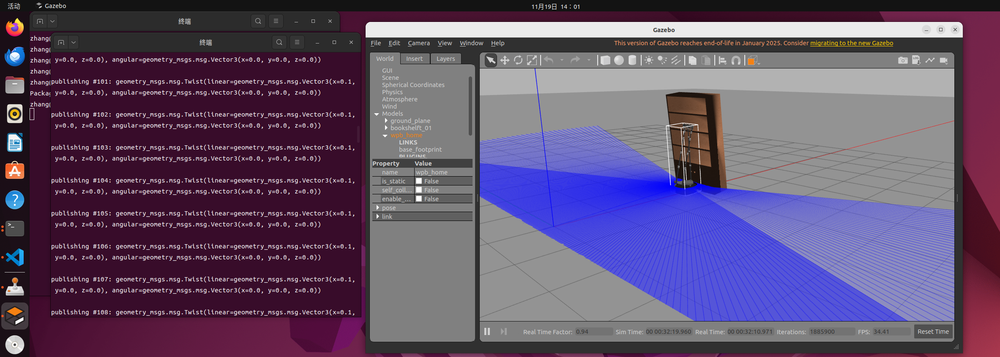
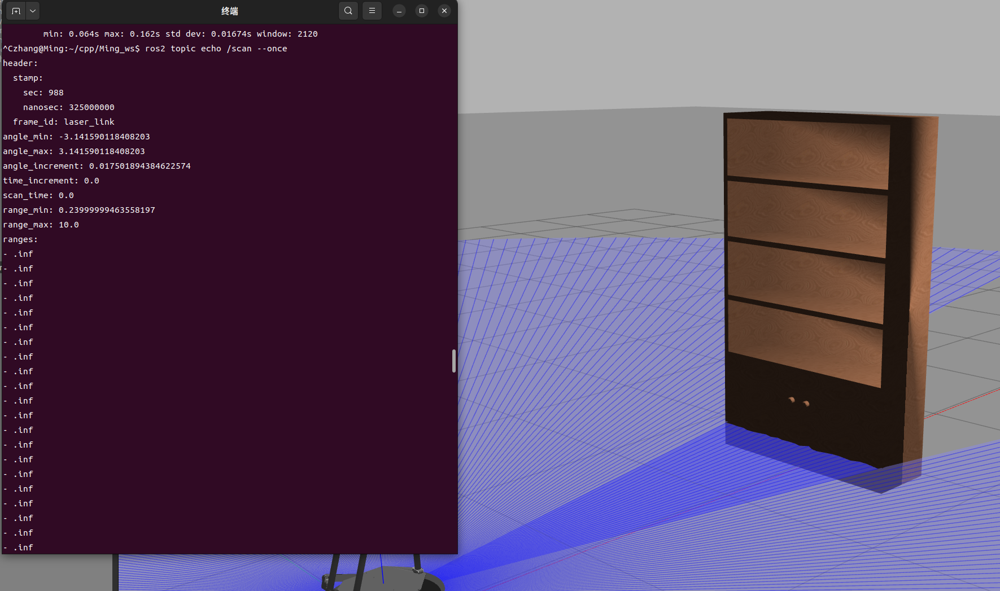
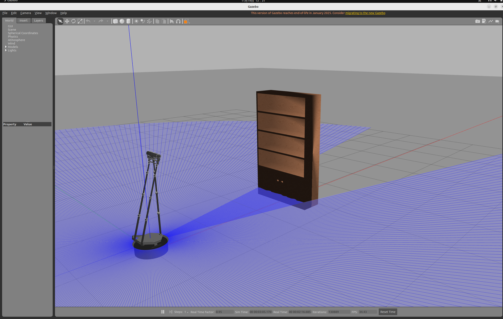
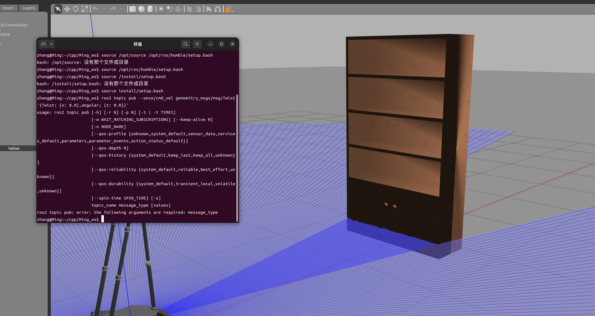
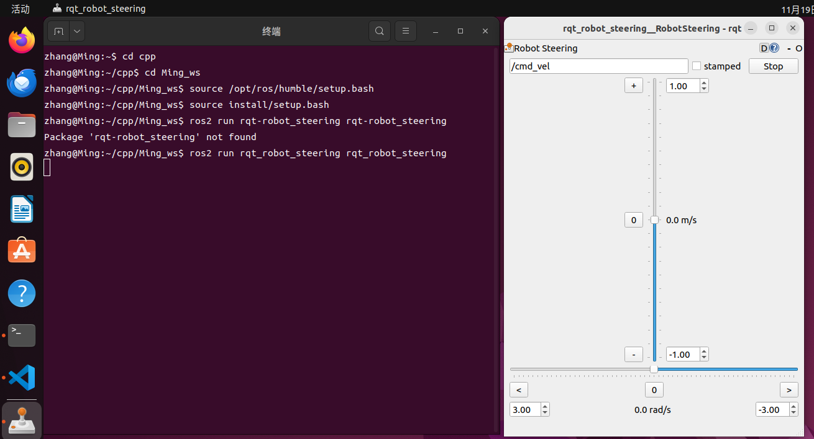

# 导航培训2 - 26智科张铭权

## 一、作业说明

在 ROS2 Humble 的 Gazebo 仿真环境里，用 `wpr_simulation2` 功能包里的 `wpb_simple.launch.py` 启动一台带激光雷达的仿真机器人 `wpb_home`，然后完成六件事：

1. 成功编译工作空间
2. 成功启动 Gazebo 仿真
3. 使用 `/cmd_vel` 控制机器人运动
4. 查看 `/scan` 激光数据
5. 完成自动连续动作
6. 完成遇障停车

`week2_demo` 是本次作业用到的两个 C++ 功能包，都可以直接用 `colcon build` 编译。

目录结构：

```text
导航培训2/
├── week2_demo/
│   └── src/
│       ├── vel_pkg/                     # 发布 /cmd_vel，让机器人前进
│       │   ├── package.xml
│       │   ├── CMakeLists.txt
│       │   └── src/
│       │       └── velocity_command.cpp
│       └── lidar_pkg/                   # 订阅 /scan，读数据 + 遇障停车
│           ├── package.xml
│           ├── CMakeLists.txt
│           └── src/
│               ├── lidar_data.cpp
│               └── lidar_behavior.cpp
├── 运行截图/
│   ├── 仿真终端.png
│   ├── 启动日志.png
│   ├── Gazebo画面.png
│   ├── 激光数据.png
│   ├── 避障停车.png
│   ├── cmd_vel控制运动.png
│   └── 激光扫描可视化.png
└── README.md
```

## 二、运行环境

- Ubuntu 22.04（VirtualBox 虚拟机）
- ROS2 Humble
- Gazebo（随 ROS2 Humble 一起安装）
- `wpr_simulation2` 仿真功能包（北京六部工坊 s-robot 开源包）
- colcon 构建工具

## 三、准备仿真包

```bash
mkdir -p ~/cpp/Ming_ws/src
cd ~/cpp/Ming_ws/src
git clone https://gitee.com/s-robot/wpr_simulation2.git
cd wpr_simulation2/scripts
./install_for_humble.sh        # 装依赖，需要输 sudo 密码
```

编译仿真包和本作业包：

```bash
cd ~/cpp/Ming_ws
source /opt/ros/humble/setup.bash
colcon build
```

看到 `Summary: 1 package finished` 才算编译成功。**如果中途打断了编译，`install/` 里会留下半成品，必须 `rm -rf build install log` 后整包重编**，否则后面会报 `Package 'wpr_simulation2' not found`。

## 四、启动仿真（终端 1）

```bash
cd ~/cpp/Ming_ws
source /opt/ros/humble/setup.bash
source install/setup.bash
ros2 launch wpr_simulation2 wpb_simple.launch.py
```

注意文件名是 `wpb_simple.launch.py`，不是 `wpr_simple.launch.py`。

启动成功的关键日志：

```text
[gzserver-1]  process started with pid [...]
[gzclient-2]  process started with pid [...]
[spawn_entity.py] Spawn status: SpawnEntity: Successfully spawned entity [wpb_home]
```



Gazebo 窗口里能看到房间、木柜、地面网格，以及一台带传感器支架的小车：



> 虚拟机里 `gzclient` 偶尔会因为虚拟显卡崩溃（`context mismatch in svga_surface_destroy`）。
> 这时 `gzserver`、话题、TF 都是正常的，`ros2 topic list` 照样能查到 `/cmd_vel`、`/scan`，
> 重新启动一次一般就能恢复图形窗口。

## 五、编译并运行本作业代码（终端 2）

```bash
cd ~/cpp/Ming_ws
source /opt/ros/humble/setup.bash
source install/setup.bash
colcon build --packages-select vel_pkg lidar_pkg
```

编译前先把 `week2_demo/src` 下的 `vel_pkg`、`lidar_pkg` 拷到工作空间的 `src` 目录：

```bash
cp -r week2_demo/src/* ~/cpp/Ming_ws/src/
```

## 六、六项任务的验证方式

### 1. 成功编译工作空间

```bash
colcon build
# 预期：Summary: 1 package finished
```

### 2. 成功启动 Gazebo 仿真

```bash
ros2 launch wpr_simulation2 wpb_simple.launch.py
# 预期：Successfully spawned entity [wpb_home]
```

### 3. 使用 /cmd_vel 控制机器人运动

看话题列表和类型：

```bash
ros2 topic list                       # 应能看到 /cmd_vel、/scan、/odom、/tf
ros2 topic type /cmd_vel              # geometry_msgs/msg/Twist
```

命令行直接发速度指令（`-r 10` 表示每秒发 10 次，底盘有超时看门狗，发一次不够）：

```bash
ros2 topic pub -r 10 /cmd_vel geometry_msgs/msg/Twist '{linear: {x: 0.1}, angular: {z: 0.0}}'
```

也可以用作业包里的节点来发：

```bash
ros2 run vel_pkg velocity_command
```

机器人以 0.1 m/s 前进，Gazebo 里能明显看到位置变化：



**让它停下来**，发一条全 0 的指令：

```bash
ros2 topic pub --once /cmd_vel geometry_msgs/msg/Twist '{linear: {x: 0.0}, angular: {z: 0.0}}'
```

或者直接 `Ctrl+C` 掉发指令的那个终端，机器人会在底盘超时后自动停下。

### 4. 查看 /scan 激光数据

```bash
ros2 topic echo /scan --once          # 看一整帧：angle_min、angle_max、angle_increment、ranges
ros2 topic hz /scan                   # 约 10 Hz
```

`ranges` 数组每一项是一束激光测到的距离，单位米；`inf` 表示这一束没有打到东西。

第 i 束对应的角度公式：

```text
angle_i = angle_min + i * angle_increment
```

用作业包里的节点把正前方那一束打印出来：

```bash
ros2 run lidar_pkg lidar_data
# 预期：ranges[180] = 3.141593 m 这类输出，10 Hz 打印一次
```



Gazebo 里那一片蓝色的扇形线，就是这台机器人的激光扫描范围：



### 5. 完成自动连续动作

```bash
ros2 run lidar_pkg lidar_behavior
```

这个节点把「读激光」和「发速度」连成一个闭环：**前方 > 1.5 m 就直行，≤ 1.5 m 就原地转向，不需要人再敲命令**，机器人会自己在房间里连续走。

### 6. 完成遇障停车

同一个 `lidar_behavior` 节点就是遇障行为的实现，核心逻辑：

```cpp
if (fMidDist < 1.5f)      // 正前方 1.5 m 内有东西
{
    vel_msg.angular.z = 0.3;   // 转向避让
    nCount = 100;              // 保持转向 100 帧，避免原地抖动
}
else
{
    vel_msg.linear.x = 0.1;    // 前方安全，继续前行
}
```

机器人走到木柜前停住/转向：



### 终端各自截图



## 七、常见报错

| 报错 | 原因 | 处理 |
| --- | --- | --- |
| `ros2: 未找到命令` | 新终端没 source | `source /opt/ros/humble/setup.bash` |
| `Package 'wpr_simulation2' not found` | 编译中途被打断，`install/` 是半成品 | `rm -rf build install log` 后重新 `colcon build`，等到 finished |
| `file ... was not found in the share directory` | 启动文件名打错 | 是 `wpb_simple.launch.py` |
| `could not convert string to float: 'o.o'` | 把字母 o 当成了数字 0 | 改回 `0.0` |
| `Frame [map] does not exist` | RViz 的 Fixed Frame 用了仿真里不存在的 `map` | 改成 `base_footprint` |

把下面两行写进 `~/.bashrc`，以后新终端就不用手动 source：

```bash
echo "source /opt/ros/humble/setup.bash" >> ~/.bashrc
echo "[ -f ~/cpp/Ming_ws/install/setup.bash ] && source ~/cpp/Ming_ws/install/setup.bash" >> ~/.bashrc
```
