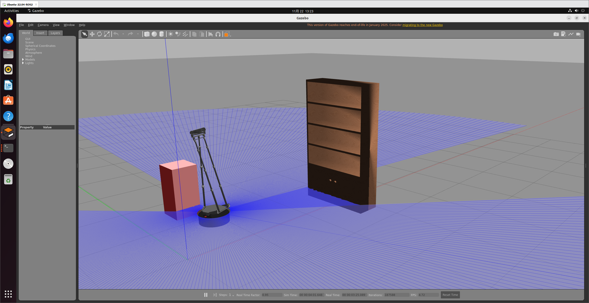
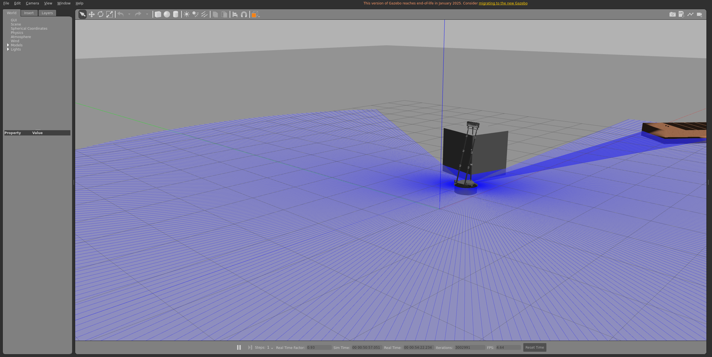
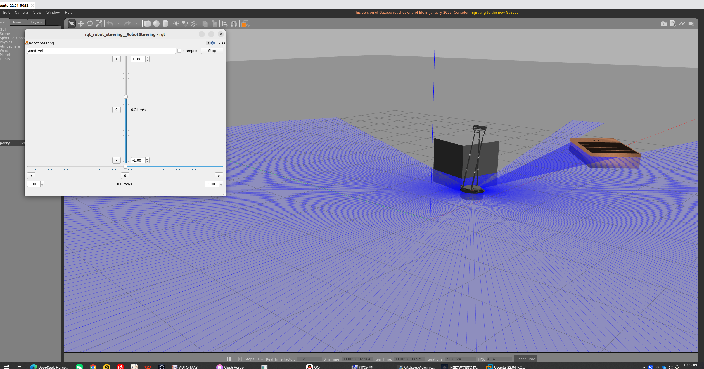
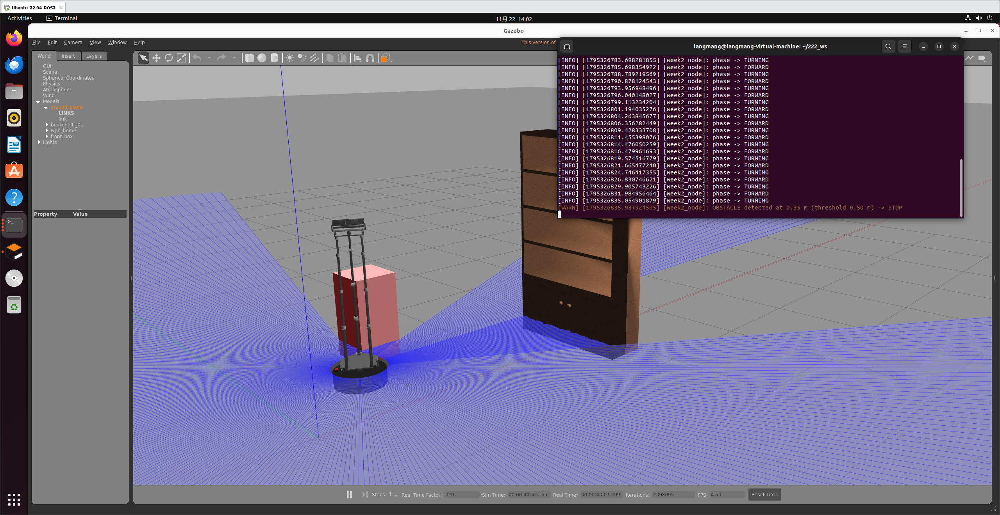
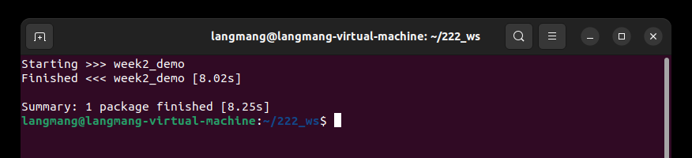
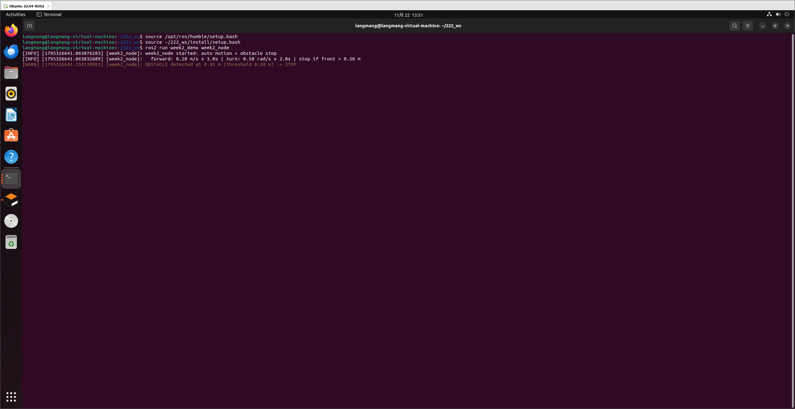
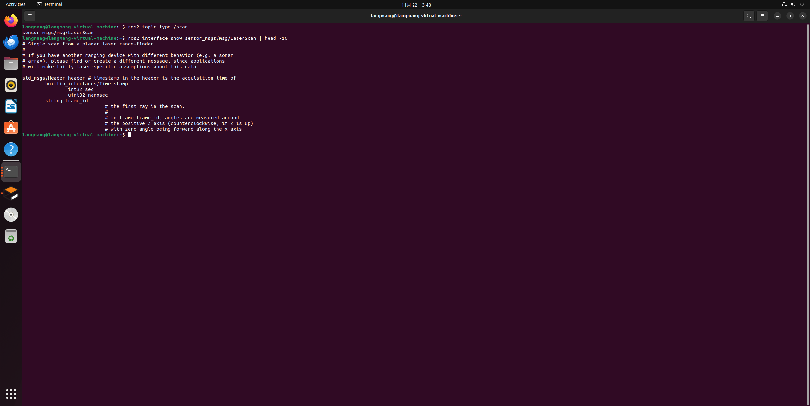

# 导航培训2 · Gazebo 仿真下的自动动作与遇障停车

一个 `ament_cmake` 功能包 `week2_demo`，用 C++ 写一个节点完成两件事：

- **自动连续动作**：前进 3 秒 → 原地转弯 2 秒，循环往复，不用人工发指令
- **遇障停车**：激光雷达检测到正前方 0.5 米内有障碍物，立即停车；障碍解除后自动继续

节点以 10 Hz 往 `/cmd_vel` 发速度指令，同时订阅 `/scan` 做避障判断。

## 环境

| 项 | 版本 |
|---|---|
| 系统 | Ubuntu 22.04.5 LTS（VMware 虚拟机） |
| ROS2 | Humble（`/opt/ros/humble`） |
| 仿真 | Gazebo Classic 11.10.2 |
| 仿真包 | `wpr_simulation2` |
| 编译器 | g++ 11.4.0 |
| 构建工具 | colcon |

> 培训 1 用的是 Ubuntu 26.04 + ROS2 Lyrical，但培训 2 要跑 `wpr_simulation2`，它依赖 Gazebo Classic 11。Gazebo Classic 已经停止维护，只支持到 Humble / Iron 这一代，所以这里用的是 Ubuntu 22.04 + Humble。包里自带的安装脚本也只有 `install_for_humble.sh` 一个版本。

## 目录

```
导航培训2/
├── week2_demo/
│   ├── package.xml
│   ├── CMakeLists.txt
│   ├── src/
│   │   └── week2_node.cpp
│   └── launch/
│       └── week2_demo.launch.py
├── 运行截图/
│   ├── 仿真终端.png
│   ├── 启动日志.png
│   ├── Gazebo画面.png
│   ├── 激光数据.png
│   ├── 激光扫描可视化.png
│   ├── cmd_vel控制运动.png
│   └── 遇障停车.png
└── README.md
```

## 编译

**第 0 步：先 source ROS2 环境。** 新终端里不 source 的话，`colcon build` 会直接报找不到 `ament_cmake`。

```bash
source /opt/ros/humble/setup.bash
```

确认一下发行版：

```bash
echo $ROS_DISTRO     # 应该输出 humble
```

**第 1 步：把 `week2_demo` 复制到工作空间的 `src/` 下。**

`week2_demo` 就在本 README 同级的目录里（即 `导航培训2/week2_demo/`）。先 `cd` 进 `导航培训2/`，再执行：

```bash
# 在 导航培训2/ 目录下执行（这个目录里能看到 week2_demo/ 和 运行截图/）
mkdir -p ~/222_ws/src
cp -r week2_demo ~/222_ws/src/
cd ~/222_ws
colcon build --packages-select week2_demo
```

编译成功的标志：

```
Starting >>> week2_demo
Finished <<< week2_demo [8.02s]

Summary: 1 package finished [8.25s]
```

> 整个包只有一个源文件，改代码后全量编译 8~13 秒；没改代码再跑一次是增量构建，1 秒左右。看到 `Summary: 1 package finished` 就行。

**第 2 步：source 工作空间**，不然 `ros2 run` 找不到这个包。

```bash
source install/setup.bash
```

## 启动

### 前置：仿真要能显示出来

Gazebo 在虚拟机里跑，必须做这几件事，缺一个都出问题：

```bash
export DISPLAY=:0                                    # 或 :1，看你自己会话
export XAUTHORITY=/run/user/1000/gdm/Xauthority      # 不设的话雷达插件加载不出来
export LIBGL_ALWAYS_SOFTWARE=1                       # 软件渲染，虚拟机没 GPU
export GALLIUM_DRIVER=llvmpipe
```

另外 `GAZEBO_MODEL_PATH` 要指到仿真包的安装目录，否则模型的 `.dae` 网格加载失败，机器人只显示一个碰撞体轮廓：

```bash
export GAZEBO_MODEL_PATH=~/222_ws/install/wpr_simulation2/share:/usr/share/gazebo-11/models
export GAZEBO_RESOURCE_PATH=~/222_ws/install/wpr_simulation2/share:/usr/share/gazebo-11
```

### 终端 1：起仿真

```bash
ros2 launch wpr_simulation2 wpb_simple.launch.py
```

出画面要等 **3 分钟左右**（软件渲染慢）。

### 终端 2：起我们的节点

```bash
ros2 run week2_demo week2_node
```

也可以用包里的 launch 一次起仿真和节点：

```bash
ros2 launch week2_demo week2_demo.launch.py
```

## 运行效果

节点起来后会看到：

```
[INFO] [week2_node]: week2_node started: auto motion + obstacle stop
[INFO] [week2_node]:   forward: 0.20 m/s x 3.0s | turn: 0.50 rad/s x 2.0s | stop if front < 0.50 m
[INFO] [week2_node]: phase -> FORWARD
[INFO] [week2_node]: phase -> TURNING
[INFO] [week2_node]: phase -> FORWARD
...
```

`FORWARD` 和 `TURNING` 交替出现，说明自动连续动作在跑。机器人位置会持续变化，`ros2 topic echo /odom --once` 可以验证。

在机器人正前方放个障碍物，会看到：

```
[WARN] [week2_node]: OBSTACLE detected at 0.35 m (threshold 0.50 m) -> STOP
```

障碍物移走后：

```
[INFO] [week2_node]: path clear (front min inf m) -> resume motion
[INFO] [week2_node]: phase -> FORWARD (resume)
```

## 截图

**Gazebo 画面**：机器人、书柜、木箱，蓝色射线是激光扫描范围。



**激光扫描可视化**：射线打到书柜的地方有缺口，没打到的方向延伸出去就断了。



**手控运动**：用 `rqt_robot_steering` 拖滑块往 `/cmd_vel` 发 0.24 m/s。



**遇障停车**：前方 0.35 米有障碍，速度归零。



**启动日志**：



**节点运行输出**：



**激光数据**：



---

## 参数

都在 `week2_node.cpp` 的 `Week2Node()` 构造函数里：

| 参数 | 默认值 | 说明 |
|---|---|---|
| `forward_speed_` | 0.2 m/s | 前进线速度 |
| `turn_speed_` | 0.5 rad/s | 转弯角速度 |
| `forward_duration_` | 3.0 s | 前进持续时长 |
| `turn_duration_` | 2.0 s | 转弯持续时长 |
| `obstacle_distance_` | 0.5 m | 遇障停车阈值 |
| `front_half_angle_` | 0.3 rad | 「正前方」的半角范围 |

## 代码要点

**话题和消息类型**

| 方向 | 话题 | 类型 |
|---|---|---|
| 发布 | `/cmd_vel` | `geometry_msgs/msg/Twist` |
| 订阅 | `/scan` | `sensor_msgs/msg/LaserScan` |

**遇障判断：索引换算**

`/scan` 的角度范围是 `[-π, +π]`，正前方是 **0 弧度**。它在 `ranges[]` 里的位置不是固定的一半，要按雷达参数算：

```cpp
const int center = static_cast<int>(
  std::round((0.0 - msg->angle_min) / msg->angle_increment));
```

wpr_simulation2 的雷达 `angle_min = -π`、`angle_increment ≈ 0.0175`，所以中心索引在 180 附近（数组共 258 点）。

**跳过无效读数**

无反射时 `ranges[i]` 是 `inf`；太近（小于 `range_min`）时给的是 `0.0`。这两种都要跳过，否则会把「没东西」当成「贴脸障碍」：

```cpp
if (!std::isfinite(r) || r < msg->range_min) {
  continue;
}
```

实际踩到的现象：机器人刚启动时 `/scan` 里有一堆 `0.0`，如果不做这个过滤，节点一起来就报 OBSTACLE 停住不动。

**日志只在状态翻转时打**

每 0.1 秒判一次障碍，如果每次都打日志会刷屏。所以只在 `obstacle_detected_` 变化时输出：

```cpp
const bool blocked = (min_dist < obstacle_distance_);
if (blocked != obstacle_detected_) {
  if (blocked) {
    RCLCPP_WARN(this->get_logger(), "OBSTACLE detected at %.2f m -> STOP", min_dist);
  } else {
    RCLCPP_INFO(this->get_logger(), "path clear -> resume motion");
  }
}
```

**两个必须写的 install**

```cmake
# 不写这个，ros2 run 报找不到可执行文件
install(TARGETS week2_node DESTINATION lib/${PROJECT_NAME})

# 不写这个，ros2 launch 报找不到 launch 文件
install(DIRECTORY launch DESTINATION share/${PROJECT_NAME})
```

**package.xml 要声明 launch 依赖**

`launch` 文件用到 `launch` 和 `launch_ros`，但 `ros2 pkg create --dependencies` 不会自动加，得手动补：

```xml
<exec_depend>launch</exec_depend>
<exec_depend>launch_ros</exec_depend>
```

不加的话别人在他环境里 `ros2 launch` 会报缺依赖。

## 跑过的步骤

1. `source /opt/ros/humble/setup.bash`，`echo $ROS_DISTRO` 出 `humble`
2. `colcon build --packages-select week2_demo`，看到 `Summary: 1 package finished`
3. `ros2 launch wpr_simulation2 wpb_simple.launch.py`，等 3 分钟出画面
4. `ros2 topic list` 能列出 `/cmd_vel`、`/scan`、`/odom`
5. `ros2 topic type /cmd_vel` 出 `geometry_msgs/msg/Twist`，`ros2 topic type /scan` 出 `sensor_msgs/msg/LaserScan`
6. `rqt_robot_steering` 拖滑块，机器人往前走，`/cmd_vel` 读到 0.24 m/s
7. `ros2 topic echo /scan --once`，`ranges` 里有正常距离值，也有 `inf`
8. `ros2 run week2_demo week2_node`，`FORWARD` 和 `TURNING` 交替刷
9. 正前方放个方盒，报 `OBSTACLE detected -> STOP`，`/cmd_vel` 归零

`colcon build` 开了 `-Wall -Wextra -Wpedantic`，没警告。`ros2 pkg executables week2_demo` 能列出 `week2_node`。
